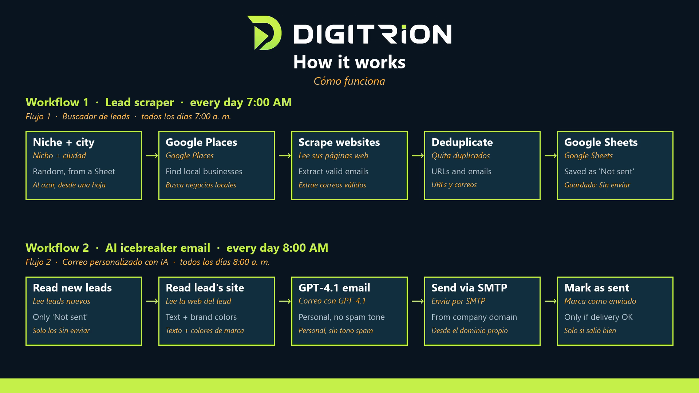
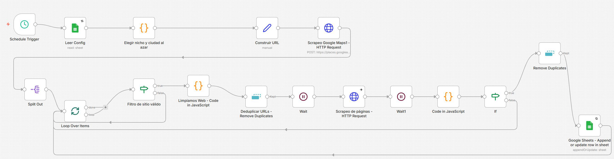
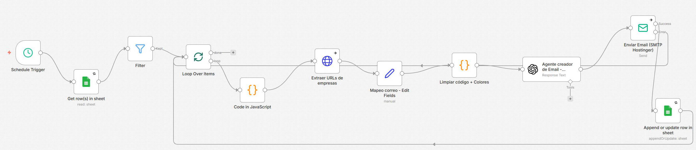
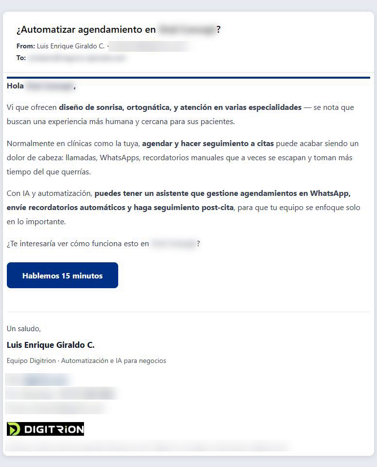

# AI Lead Generation + Personalized Cold Email (n8n + GPT-4.1)

Finding prospects and writing to each one by hand doesn't scale. I **adapted and extended an n8n template** into two daily workflows that run in production:

- **7 AM — Scraper:** picks a niche and city from Google Sheets, finds businesses with Google Places, reads their websites and saves validated, deduplicated emails.
- **8 AM — Icebreaker:** GPT-4.1 reads each lead's website and writes a personal email with anti-spam rules and a real signature, sent by SMTP from the company domain. A lead is marked *sent* only if delivery succeeds.

## Workflow 1 — Scraper

## Workflow 2 — Icebreaker

## A real email it wrote

Business name and recipient blurred.

## What I added to the original template

- Google Sheets as the control panel: niches and cities editable without touching n8n
- Website scraping with browser-like headers
- Email validation and deduplication
- Anti-spam copy rules, real signature, 110-word limit
- Own SMTP from the company domain
- Fault tolerance: one failed send never stops the run

## Import

The workflow JSON files are in [`workflows/`](workflows/):

| File | Nodes | Runs |
|---|---|---|
| [`1-google-maps-lead-scraper.json`](workflows/1-google-maps-lead-scraper.json) | 17 | Daily, 7 AM |
| [`2-ai-icebreaker-cold-email.json`](workflows/2-ai-icebreaker-cold-email.json) | 11 | Daily, 8 AM |

In n8n: **Workflows → Import from file**, then:

1. Connect your own credentials: Google Sheets, Google Places API key (header `X-Goog-Api-Key`), OpenAI and SMTP. **No credentials are included.**
2. Replace `YOUR_GOOGLE_SHEET_ID` with your sheet. It needs a `Config` tab (columns `Nicho`, `Ciudad`) and a leads tab (columns `Web`, `Correo`, `Correo Icebreaker`, `Estado`, `Fecha envio`).
3. Set your sender address (`you@yourdomain.com`) and edit the signature and offer in the system prompt of the email node. The prompt is in Spanish because the prospects are in Colombia.

## Stack

n8n · Google Places API · Google Sheets · OpenAI GPT-4.1 · SMTP

---

Built by **Luis E. Giraldo** — n8n & AI automation engineer (Digitrion). Available on Upwork.
